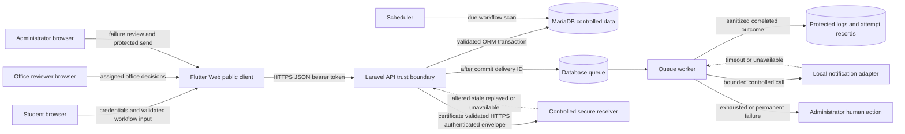
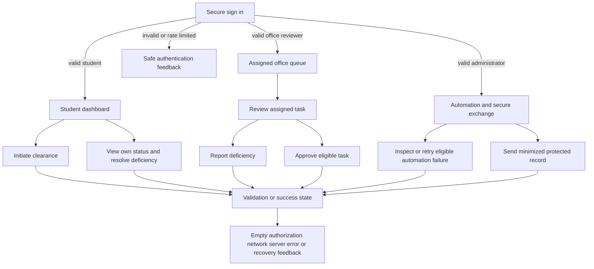

# Week 15 System Test Design

## Purpose

This document defines the actors, workflow, trust boundaries, dependencies, failure paths, human decisions, and Flutter Web states that Week 15 will test. It describes the preparation baseline and does not claim that the planned Week 15 cases have already passed.

## Bounded workflow under test

1. A fictional student authenticates and initiates one clearance for the controlled academic term.
2. Laravel validates the request and creates one office task per active clearing office in one transaction.
3. Each fictional office reviewer can read and act only on tasks assigned to that office.
4. A reviewer may report a deficiency; only the owning student may submit its resolution.
5. The assigned office re-reviews the resolved deficiency or approves an eligible task.
6. Completion occurs once after every required office task is approved.
7. Scheduled automation creates bounded reminders, stalled-step escalation, and one completion notification.
8. An administrator inspects permanent automation failures and may retry only an eligible delivery.
9. An administrator may send a minimized clearance record to the controlled HTTPS receiver.

## Trigger inputs processing outputs dependencies and non-goals

| Element | Week 15 definition |
| --- | --- |
| Trigger | Authenticated browser/API action, scheduled automation scan, queued delivery, or administrator-reviewed retry. |
| Trusted inputs | Server-authenticated user ID, role, office assignment, server-owned object relationships, active-office configuration, and server-generated identifiers. |
| Untrusted inputs | Request JSON, route identifiers, idempotency key, correlation header, client role or owner fields, and any browser-visible state. |
| Processing | Request validation, role and ownership authorization, transactional state transition, bounded dependency call, safe error mapping, and structured logging. |
| Outputs | Versioned JSON response, correlation header, auditable state changes, automation attempts, human-action item, and understandable Flutter feedback. |
| Dependencies | MariaDB, Laravel Sanctum, database queue and scheduler, local notification adapter, controlled HTTPS receiver, Flutter Web browser runtime. |
| Non-goals | Production deployment, real identity provider, real student records, real email/SMS, large-scale load certification, mobile packaging, or a production-readiness claim. |

## Data flow trust boundaries and failure paths

## Trust boundary controls to verify

| Boundary | Sensitive or authoritative information | Required checks |
| --- | --- | --- |
| Browser to API | Credentials, bearer token, role, ownership, workflow input | TLS for credential-bearing API calls, authentication, role and object authorization, validation, rate control, safe errors, correlation ID. |
| API to database | Object ownership, state, audit events, deficiency details | Transactions, row/state checks, unique constraints, no partial records, no cross-student or cross-office access. |
| Queue to adapter | Delivery ID, retry count, outcome | Timeout, bounded retry, idempotency, one intended effect, safe log fields, human routing. |
| Sender to secure receiver | Minimized clearance payload and server keys | HTTPS certificate validation, HMAC service authentication, AES-GCM integrity, freshness, expiry, replay rejection, protected configuration. |

## Human approval and intervention points

- Clearing-office personnel make deficiency and approval decisions for their assigned office.
- The owning student chooses the resolution note and submits it for re-review.
- An administrator reviews stalled work and permanent automation failure before an eligible retry.
- The instructor is the academic acceptance authority for the Week 15 evidence.
- Automation never approves a deficiency, changes an office decision, or silently discards permanent failure.

## Flutter Web screen flow under test

## Reusable Flutter elements and states

| Area | Existing reusable element | Week 15 verification |
| --- | --- | --- |
| Application shell | `AppShell` | Role-derived navigation, keyboard order, readable labels, narrow layout. |
| State feedback | `StatePanel` widgets | Loading, empty, authorization, network, server error, and recovery language. |
| API boundary | `ClearanceApi` | Status mapping, safe error parsing, correlation information where exposed, no secret storage. |
| Student form | Student dashboard initiation and resolution controls | Client validation agrees with authoritative server validation. |
| Office workflow | Office dashboard queue and review actions | Assigned-office boundary and invalid-state feedback. |
| Administrator workflow | Admin dashboard automation and secure-send actions | Function authorization, bounded retry, protected exchange feedback. |

## Controlled failure prediction

Before execution, the selected controlled failure is a notification dependency timeout during a queued reminder delivery. The expected result is a bounded retry cycle with the same logical delivery and correlation context, no duplicate notification effect, a sanitized actionable failure record, and human action after the final allowed attempt. The exact injected behavior and actual outcome will be recorded separately; this prediction is not a passed result.

## Maintenance and residual limitations

- The diagrams must be updated if routes, roles, state transitions, or dependencies change.
- The controlled notification and HTTPS receiver are classroom substitutes, not production services.
- Browser screenshots will prove visible states and responsive behavior, not internal database safety.
- Automated tests and collection results will prove only the documented controlled environment and data.
- Concurrency and performance checks will remain bounded to what the local environment can repeat honestly.
